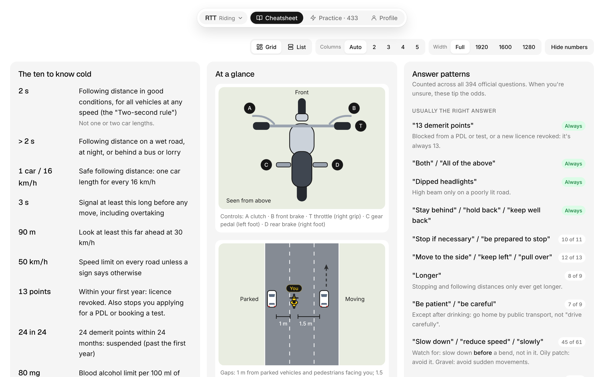
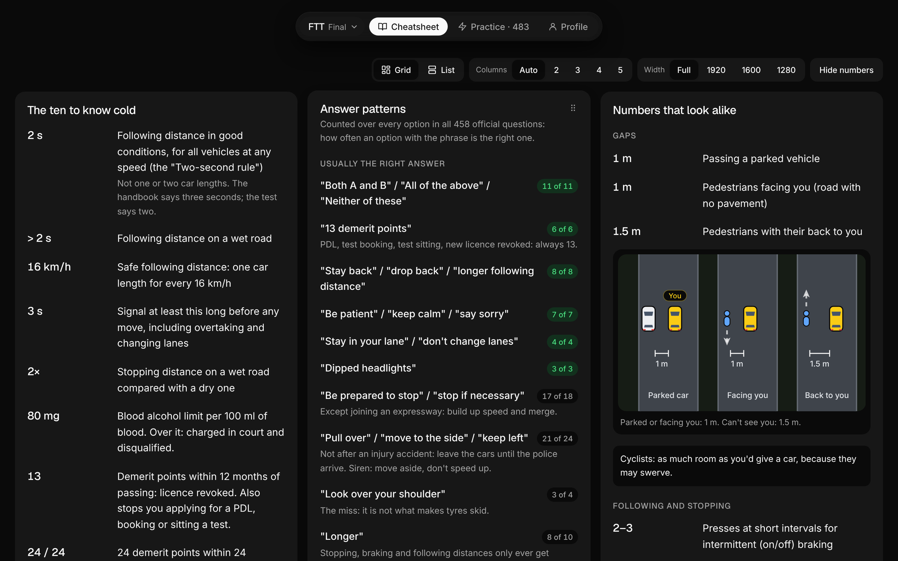
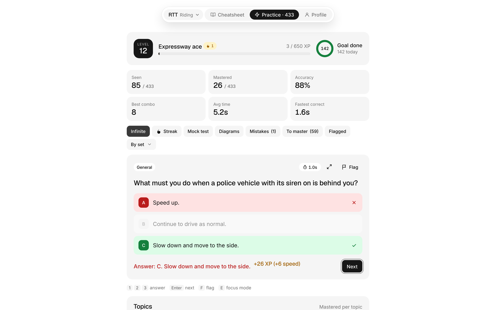
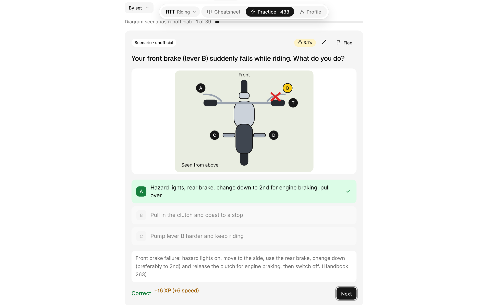
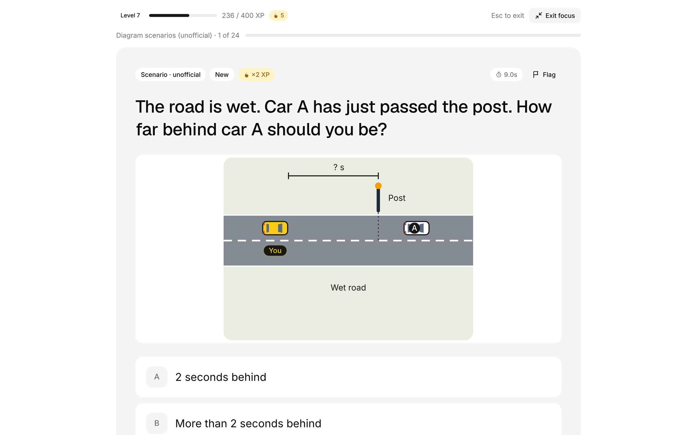
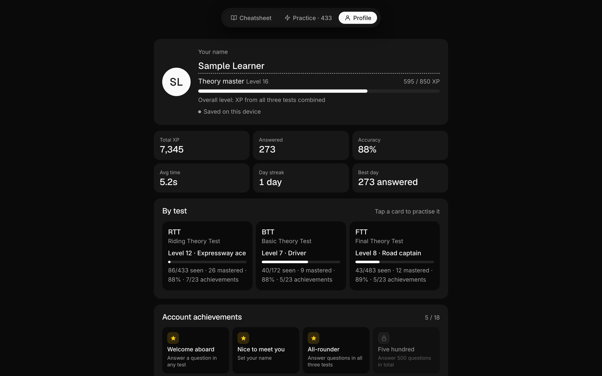
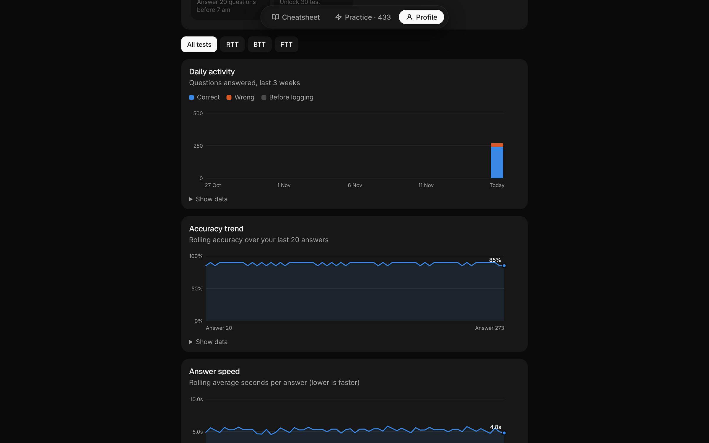
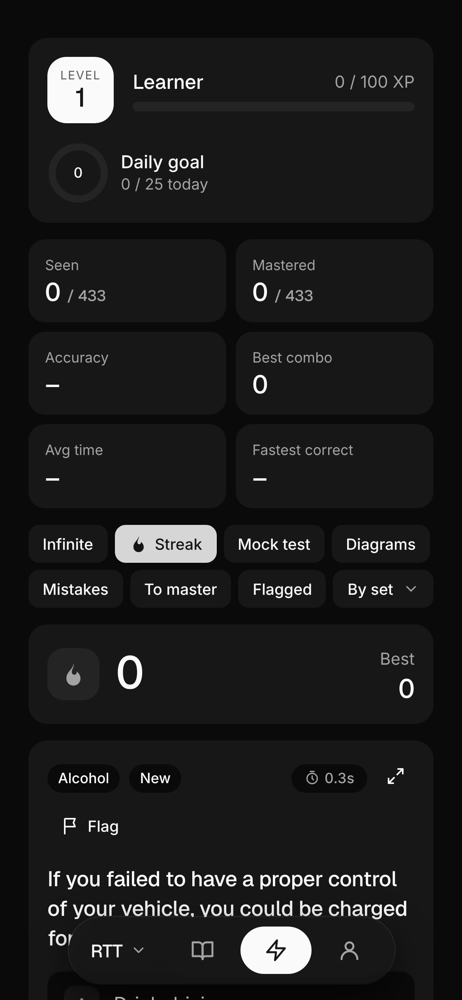
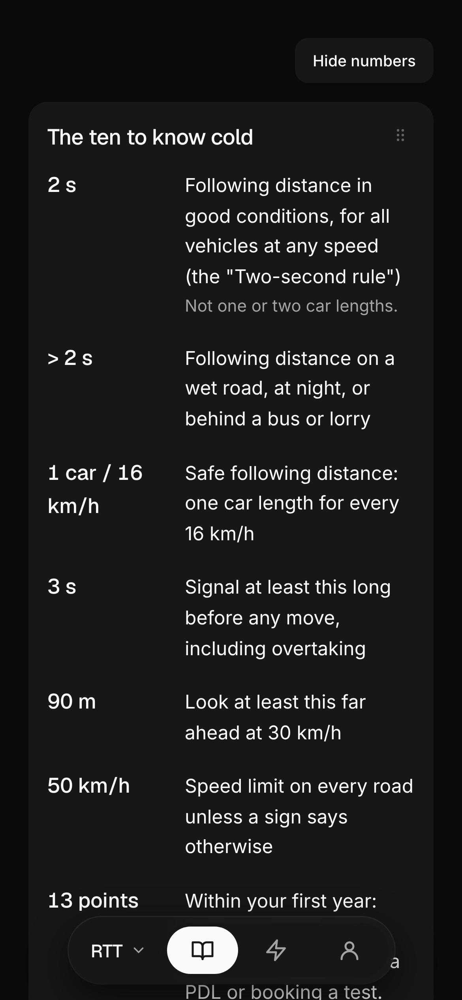

# SG Theory Prep

A single-page study app for Singapore's driving and riding theory tests: the **Riding Theory Test (RTT)**, **Basic Theory Test (BTT)** and **Final Theory Test (FTT)**.

**[Open the live app →](https://claude.ai/artifact/UgQ2WVaFQFtoM6t6YZRKEa)**

It packs every official Traffic Police practice question, fact-checked cheatsheets, drawn diagram scenarios and a gamified practice loop into one HTML file. Progress syncs to your Claude account when you open the live app signed in. The standalone `index.html` keeps it in your browser.



## What's inside

| | RTT (motorcycle) | BTT | FTT (car) |
|---|---|---|---|
| Official practice questions | 394 | 148 | 458 |
| Diagram scenarios (unofficial, from handbook rules) | 39 | 24 | 25 |
| Cheatsheet | ✓ | ✓ | ✓ |

The official questions come from the Traffic Police practice forms linked from [police.gov.sg](https://www.police.gov.sg/E-Services/Practise-Driving-and-Riding-Theory-Test). Each one keeps its official answer.

### Cheatsheets

- **The ten to know cold**, **numbers that look alike** with memory hooks, and **quick rules** written as situation → answer pairs.
- **Answer patterns**, counted across every official question. For example, "13 demerit points" is the right answer every time, while "sound your horn" is right once in 20.
- **Tricky questions**, where the obvious answer is wrong. Each one shows the official trap crossed out.
- **Diagrams** of controls, gaps, lights, markings, sign shapes, lane use, bends and blind spots. All are drawn for left-hand traffic.
- **Handbook only** facts, kept apart and clearly labelled. These are in the handbook but no practice question tests them.
- **A masonry grid you can drag around.** Choose the columns (Auto, 2–5) and the maximum width. You can also switch to a list, or blur every number to quiz yourself.



### Practice

- **Infinite.** Spaced repetition that puts new questions first. Questions you get wrong come back a few questions later.
- **Streak.** Survival mode: one wrong answer ends the run.
- **Mock test.** 50 questions in 50 minutes, with 45 needed to pass.
- **To master.** Drills only the questions you've seen but haven't got right twice in a row.
- **Diagrams**, **Mistakes**, **Flagged** and **By set**.
- **Speed and scoring.** A per-question timer that pauses when you leave the tab, plus speed-bonus XP and combo multipliers.
- **Shuffled options.** Answer options are shuffled every time, except "both / all of the above" questions.
- **Focus mode** strips away everything but the question.

| Practice | Diagram scenario | Focus mode |
|---|---|---|
|  |  |  |

### Profile

- **Your name**, an overall level (titles run up to level 100), and a level for each test.
- **Achievements:** account-wide ones plus a set for each test.
- **Charts:**
  - Daily activity and accuracy trend
  - Answer speed, and speed against accuracy
  - Accuracy by topic and mastery
  - When you study, and XP earned over time

  Each chart has hover details and a data table.

| Profile | Charts |
|---|---|
|  |  |

| Phone: streak mode | Phone: cheatsheet |
|---|---|
|  |  |

<sub>Screenshots use sample progress.</sub>

## How accurate is it?

- **Questions and answers** are the official Traffic Police practice sets, downloaded from form.gov.sg. `tools/fetch_banks.py` re-downloads them, so you can confirm nothing has changed.
- **Cheatsheet facts** follow the official answers. Independent reviews checked every line against those answers and the official handbooks.
- **Where the newest handbook disagrees with a practice answer**, the cheatsheet uses the practice answer. For example, the handbook now says "three-second rule" but the questions say two seconds. Each case is noted.
- **Diagram scenarios are unofficial.** I wrote them from the handbook rules and the official answers, and each explanation cites its source.
- **The real test pool isn't public.** Expect a few questions you haven't seen.

This is an independent study aid. It isn't affiliated with the Singapore Police Force or the Traffic Police. The official handbooks are free from the Traffic Police Online Learning Portal. They aren't included in this repo.

## Build it yourself

You need Python 3 and nothing else.

```sh
python3 tools/fetch_banks.py   # optional: refresh the official question banks
./build.sh                     # draws diagrams, applies fact-check fixes, writes index.html
```

Open `index.html` in any browser. Without a Claude account, progress is kept in your browser's local storage.

```
index.html              built single-file app
build.sh                build entry point
tools/fetch_banks.py    re-downloads the official practice questions
src/
  template3.html        app shell: styles and all app logic
  build.py              assembles data, cheatsheets and diagrams into the page
  diagrams.py           shared SVG drawing kit and the RTT diagram questions
  sheet.part.html       RTT cheatsheet
  form/                 RTT question bank and diagram questions
  btt/, ftt/            question banks, diagram generators, cheatsheets
  viz/                  figure regeneration and fact-check corrections
docs/screenshots/       images used in this README
```
